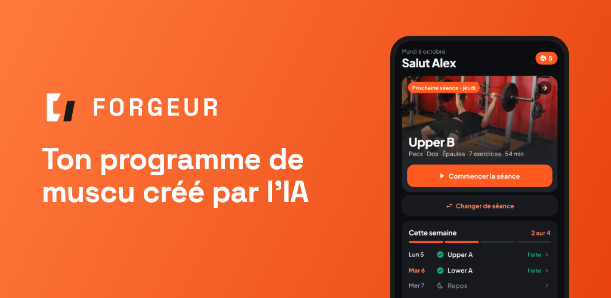
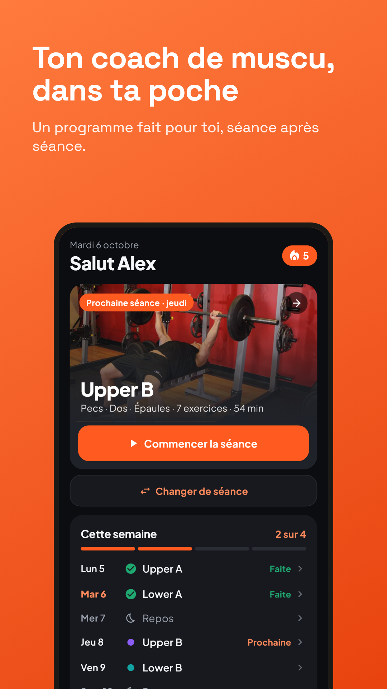
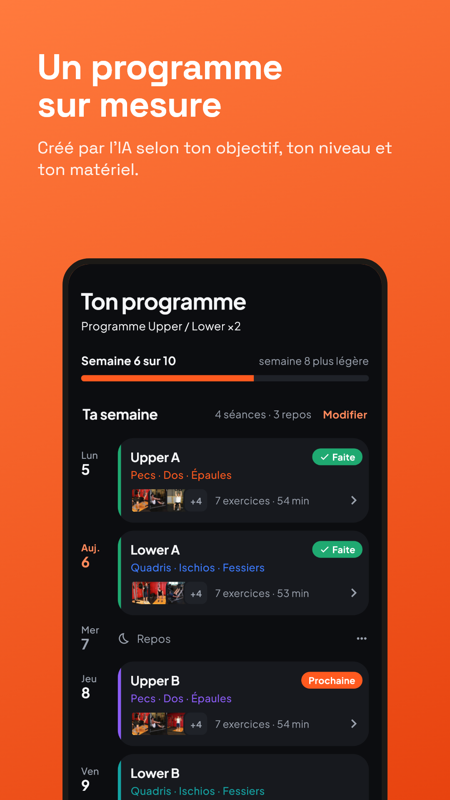
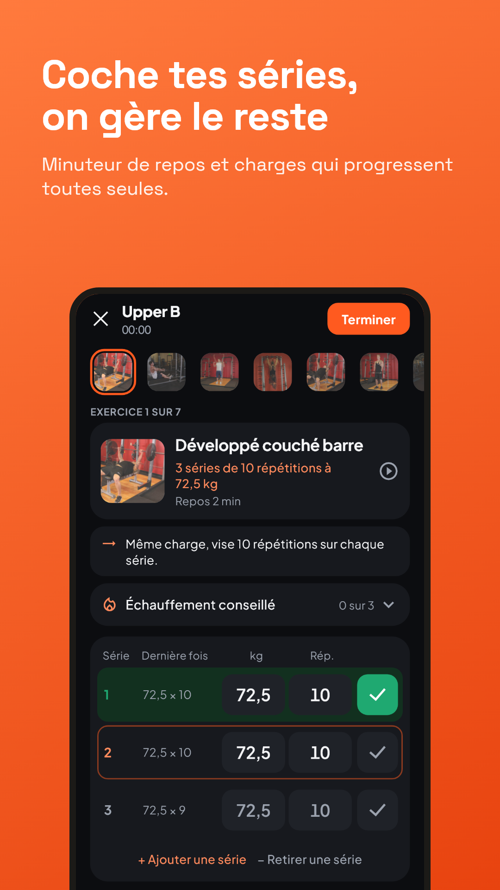
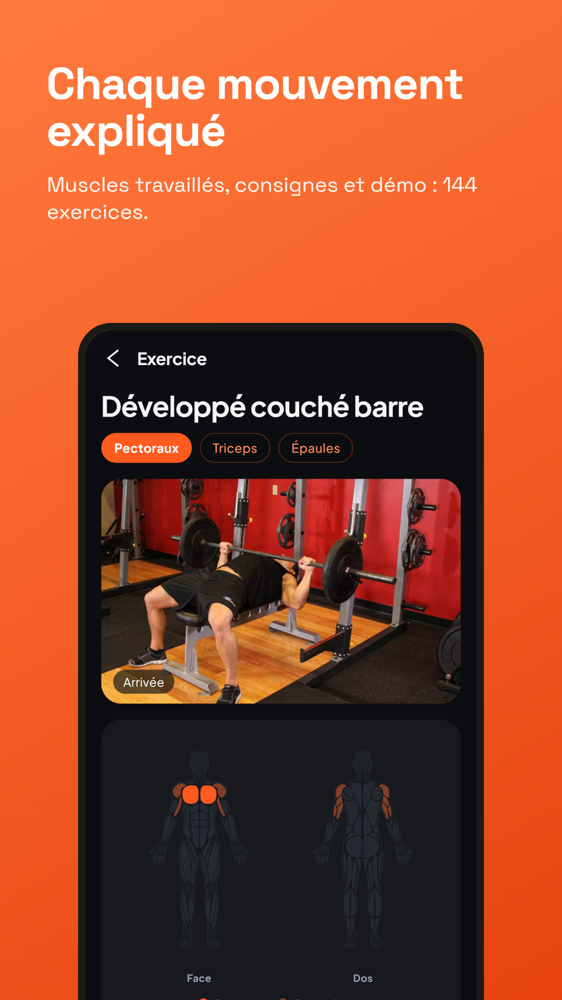
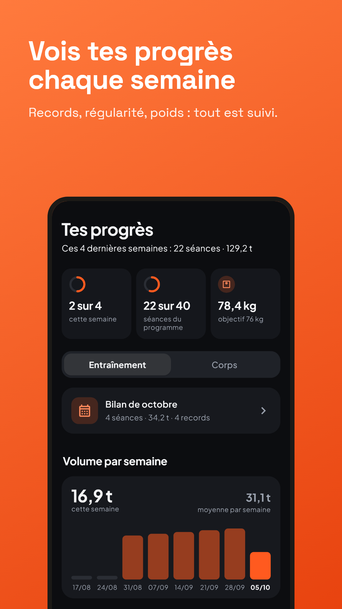
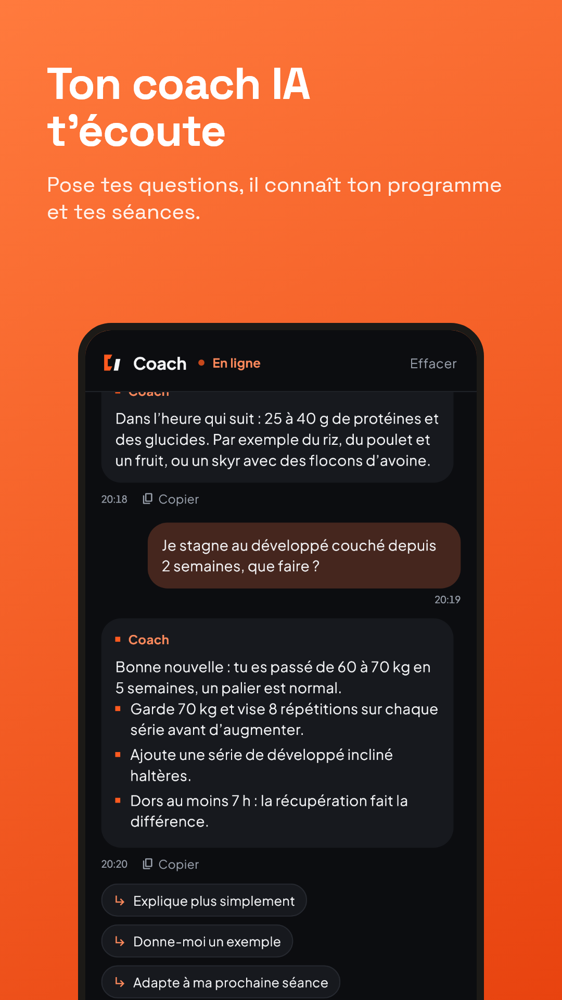

<p align="center">
  
</p>

<h1 align="center">Forgeur : coach de musculation IA</h1>

<p align="center">
  Appli Android qui crée un programme de musculation sur mesure avec l'IA,
  puis l'adapte séance après séance.
</p>



> **Dépôt vitrine.** Forgeur est destinée à être publiée sur le Play Store :
> le code source est conservé dans un dépôt privé. Cette page présente le projet,
> son architecture et les choix techniques.

## Ce que fait l'appli

| | |
| --- | --- |
| **Programme sur mesure** | L'IA crée un programme selon l'objectif, le niveau, le matériel, les jours disponibles et les zones sensibles (genoux, dos, épaules) |
| **Séances guidées** | Séries cochées d'un geste, minuteur de repos automatique, charges qui progressent selon les résultats, calcul des disques sur la barre |
| **144 exercices expliqués** | Carte des muscles, consignes d'exécution, démonstration en photos ; exercices personnalisés |
| **Suivi des progrès** | Records, régularité, volume par muscle, poids, bilans hebdomadaires et mensuels |
| **Coach IA** | Répond aux questions (entraînement, nutrition, récupération) en connaissant le programme et les séances, et peut modifier le programme sur demande |
| **Données privées** | Pas de compte, pas de publicité, pas de pistage ; tout reste sur le téléphone, avec sauvegarde et synchro Health Connect facultatives |

Disponible en français, anglais et espagnol.

## Aperçu

| | | |
| --- | --- | --- |
|  |  |  |
|  |  |  |

## Architecture

```
 Appli Android (Flutter)                  Relais IA (Cloudflare Workers)          Google Gemini
 ┌─────────────────────────┐   HTTPS      ┌──────────────────────────────┐  HTTPS  ┌────────────┐
 │ Programme, séances,     │ ───────────> │ Garde la clé API en secret   │ ──────> │ Modèles    │
 │ progrès, coach          │              │ Impose le format des réponses│         │ Gemini     │
 │ Données stockées        │ <─────────── │ Limite les abus par IP       │ <────── │            │
 │ sur le téléphone        │              │ Bascule de modèle si panne   │         └────────────┘
 └─────────────────────────┘              └──────────────────────────────┘
```

**Pourquoi un relais entre l'appli et l'IA :**

- **La clé API n'est jamais dans l'appli.** Une clé embarquée dans une appli peut être extraite par n'importe qui. Ici, elle est stockée comme secret côté serveur (`wrangler secret`), jamais dans le code ni dans l'historique Git.
- **Limitation anti-abus** par adresse IP : 6 générations de programme et 12 messages au coach par minute.
- **Haute disponibilité** : si un modèle est saturé ou trop lent, le relais bascule automatiquement sur le suivant.
- **Réponses contrôlées** : le relais impose un schéma JSON et nettoie les programmes générés avant de les renvoyer à l'appli.
- **Indépendance du fournisseur** : changer d'IA revient à modifier le relais, sans republier l'appli.

## Technologies

| Domaine | Choix |
| --- | --- |
| Appli mobile | Flutter / Dart, Material Design, 3 langues (fichiers de traduction) |
| Relais IA | Cloudflare Workers en TypeScript, limitation de débit native |
| IA | Google Gemini, sorties en JSON structuré |
| Données | Stockage local, sauvegarde Android, Health Connect |
| Notifications | Rappels de séance et alerte de fin de repos |
| Monétisation | Achats intégrés Google Play (version Premium) |
| Qualité | Tests automatisés, analyse statique (flutter_lints) |

## En chiffres

- Environ **28 000 lignes** de Dart (hors traductions) et **2 800 lignes** de TypeScript
- **144 exercices** documentés, **3 langues**
- Plus de **90 versions** depuis le début du projet (septembre 2026)

## Ma démarche

Projet conçu et piloté par moi : besoin, fonctionnalités, parcours utilisateur, design,
tests sur téléphone et choix d'architecture. **Le code a été écrit avec l'assistance de
Claude Code.** Ce projet m'a appris à piloter un développement avec l'IA, à protéger
une clé API côté serveur et à penser sécurité, disponibilité et données personnelles dès la conception.

## Contact

Paulo Rosa · [LinkedIn](https://www.linkedin.com/in/paulo-ais/) · [GitHub](https://github.com/Paulo0x)
